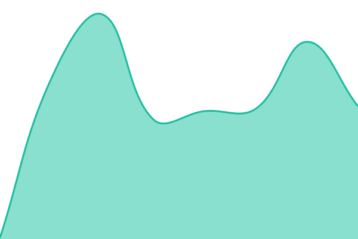

# Fang X Status

This repository contains the open-source uptime monitor and status page for [flohulo](https://flohulo.github.io/fang-x-status), powered by [Upptime](https://github.com/upptime/upptime).

## Live-Status: <!--live status--> **Alles läuft**

<!--start: status pages-->
<!-- This summary is generated by Upptime (https://github.com/upptime/upptime) -->
<!-- Do not edit this manually, your changes will be overwritten -->
<!-- prettier-ignore -->
| URL | Status | History | Response Time | Uptime |
| --- | ------ | ------- | ------------- | ------ |
|  [Fang X App](https://fang-x.freizeit.workers.dev/) | Läuft | [fang-x-app.yml](https://github.com/flohulo/fang-x-status/commits/HEAD/history/fang-x-app.yml) | 

 133ms
     
 | 

<a href="https://flohulo.github.io/fang-x-status/history/fang-x-app">100.00%</a>
    

|  [Webseite und Handbuch](https://flohulo.github.io/fang-x/) | Läuft | [webseite-und-handbuch.yml](https://github.com/flohulo/fang-x-status/commits/HEAD/history/webseite-und-handbuch.yml) | 

 154ms
     
 | 

<a href="https://flohulo.github.io/fang-x-status/history/webseite-und-handbuch">100.00%</a>
    

<!--end: status pages-->

## So funktioniert es

- **Prüfung:** Alle 5 Minuten ruft GitHub Actions die App und die Webseite auf.
- **Störungen:** Ist eine Seite nicht erreichbar, legt Upptime automatisch ein Issue an, das als
  Störung auf der Statusseite erscheint. Läuft die Seite wieder, wird das Issue geschlossen.
- **Wartung ankündigen:** Neues Issue mit der Vorlage „Geplante Wartung“ anlegen und Start, Ende
  und betroffene Seiten im Kommentar oben eintragen.
- **Neuigkeit veröffentlichen:** Neues Issue mit der Vorlage „Neuigkeit“ anlegen. Sie erscheint im
  angegebenen Zeitfenster auf der Statusseite.
- **Einstellungen:** Nur [`.upptimerc.yml`](.upptimerc.yml) bearbeiten. Die Workflows in
  `.github/workflows` erzeugt Upptime daraus und überschreibt Änderungen daran.

Die Workflows brauchen das Secret `GH_PAT` (Fine-grained Token für dieses Repo mit Schreibrecht auf
Contents, Issues und Workflows). Die Statusseite wird auf den Branch `gh-pages` gebaut.

[**Visit our status website →**](https://flohulo.github.io/fang-x-status)

Betrieben mit [Upptime](https://github.com/upptime/upptime) (MIT-Lizenz, siehe [LICENSE](LICENSE)).
